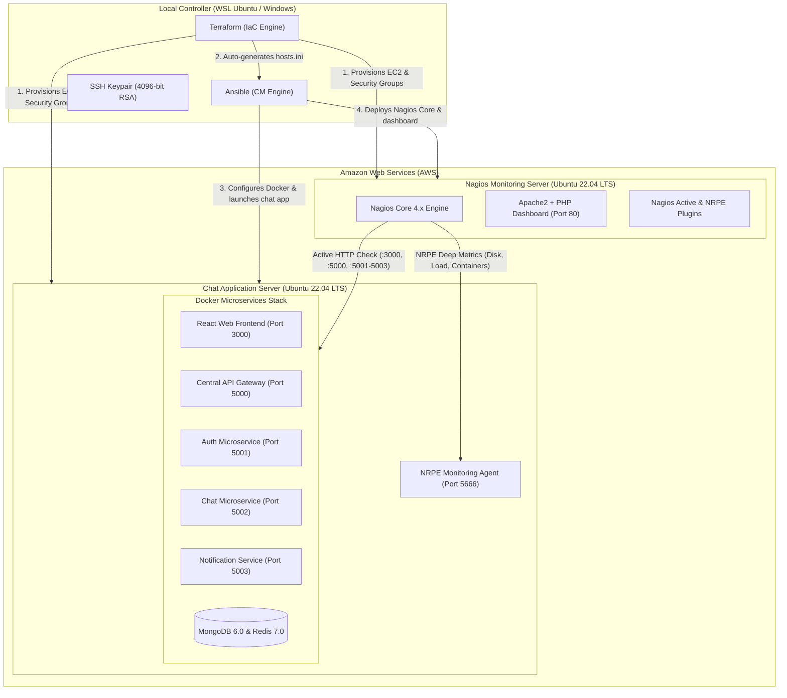

# Automated Deployment and Monitoring of a Microservices-Based Chat Application

[](https://www.terraform.io/)
[](https://www.ansible.com/)
[](https://www.docker.com/)
[](https://www.nagios.org/)
[](https://aws.amazon.com/)

> **Course:** DevOps Advance Configuration Management | B.Tech 7th Semester  
> **Author:** Prince Kumar  
> **Chat Application Repository:** [prince093kumar/winter_pep_final_project](https://github.com/prince093kumar/winter_pep_final_project)

---

## 📖 Executive Summary

Modern enterprise software systems demand agility, reliability, and continuous observability. Manually provisioning servers, configuring dependencies, and monitoring distributed services introduces configuration inconsistencies and delayed fault detection.

This project delivers a complete, end-to-end DevOps automation pipeline:
1. **Terraform (Infrastructure as Code):** Provisions cloud infrastructure on AWS (EC2 instances, security groups, SSH keys) and automatically synthesizes the dynamic Ansible inventory.
2. **Ansible (Configuration Management):** Connects to the cloud instances, configures system prerequisites, installs Docker & Docker Compose, deploys the microservices chat application, and installs Nagios Core with NRPE.
3. **Nagios Core (Continuous Monitoring):** Continuously monitors server availability, system resources (disk space, CPU load), Docker daemon health, and application HTTP endpoints.
4. **Controlled Failure Injection & Recovery:** Provides automated scripts to simulate container outages, demonstrate Nagios failure detection, and restore healthy operations.

---

## 🏛️ System Architecture



---

## 📁 Repository Structure

```
├── terraform/                      # Infrastructure as Code
│   ├── versions.tf                 # Required providers (AWS, TLS, Local)
│   ├── variables.tf                # Input variables & instance sizing
│   ├── provider.tf                 # AWS provider configuration
│   ├── key_pair.tf                 # Automated 4096-bit RSA key generation
│   ├── security_groups.tf          # App & Monitoring security groups
│   ├── ec2_instances.tf            # EC2 instance declarations (Ubuntu 22.04)
│   ├── inventory.tf                # Auto-generates ansible/inventory/hosts.ini
│   ├── outputs.tf                  # Public IPs, URLs, SSH commands
│   └── terraform.tfvars.example    # Configuration template
├── ansible/                        # Configuration Management
│   ├── ansible.cfg                 # Ansible behavior & connection tuning
│   ├── inventory/                  # Dynamic hosts.ini generated by Terraform
│   ├── group_vars/                 # Global, app, and monitoring variables
│   ├── roles/                      # Modular Ansible roles
│   │   ├── common/                 # Base packages, 2GB swap, timezone
│   │   ├── docker/                 # Docker CE Engine & Compose plugin
│   │   ├── app_deployment/         # Clones chat repo, templates override, builds containers
│   │   ├── nrpe_client/            # Nagios NRPE agent & custom container check
│   │   └── nagios_server/          # Nagios 4, Apache2, contacts, hosts, services
│   ├── site.yml                    # Master orchestration playbook
│   ├── deploy-app.yml              # App-only redeploy playbook
│   └── configure-nagios.yml        # Nagios-only reconfigure playbook
├── scripts/                        # Automation & Testing CLI Utilities
│   ├── deploy.sh                   # Master one-click deployment (Linux/WSL)
│   ├── deploy.ps1                  # Master one-click deployment (Windows PowerShell)
│   ├── test_endpoints.sh           # Microservices & Nagios health tester
│   ├── simulate_failure.sh         # Injects controlled failure for demonstration
│   ├── recover_service.sh          # Restores stopped containers
│   ├── verify_nagios.sh            # Runs CLI checks directly on monitoring server
│   ├── destroy.sh                  # Tears down AWS resources (Bash)
│   └── destroy.ps1                 # Tears down AWS resources (PowerShell)
├── docs/                           # Detailed Documentation
│   ├── ARCHITECTURE.md             # Deep-dive architecture & dataflow diagrams
│   ├── LAB_MANUAL_GUIDE.md         # Step-by-step reproduction guide
│   ├── TESTING_AND_VERIFICATION.md # Test cases matrix & failure logs
│   └── VIVA_QUESTIONS.md           # 30 viva examination questions & answers
└── README.md                       # Main project documentation
```

---

## 🚀 Quick Start Guide

### Step 1: Configure AWS CLI Credentials
Ensure your local machine or WSL Ubuntu has valid AWS credentials:
```bash
aws configure
```

### Step 2: One-Click Automated Deployment

#### On WSL Ubuntu / Linux:
```bash
chmod +x scripts/*.sh
./scripts/deploy.sh
```

#### On Windows PowerShell:
```powershell
.\scripts\deploy.ps1
```

The script automatically executes:
1. `terraform init` and `terraform apply` to create EC2 instances and Security Groups.
2. Generates `ansible/inventory/hosts.ini` with provisioned public IP addresses.
3. Waits for SSH availability on both servers.
4. Executes `ansible-playbook -i inventory/hosts.ini site.yml`.
5. Verifies all service endpoints and prints access URLs.

---

## 🌐 Access Endpoints & Default Credentials

| Component | URL | Default Credentials | Description |
| :--- | :--- | :--- | :--- |
| **React Chat Client** | `http://<APP_SERVER_IP>:3000` | - | Web frontend for users |
| **API Gateway Health** | `http://<APP_SERVER_IP>:5000/health`| - | Express API Gateway health check |
| **Nagios Core Dashboard**| `http://<MONITORING_SERVER_IP>/nagios4/`| `nagiosadmin` / `Devops@2026` | Monitoring & alerting console |

---

## 🧪 Testing & Failure Demonstration

To satisfy project evaluation and viva requirements:

### 1. Test All Endpoints:
```bash
./scripts/test_endpoints.sh
```
Checks HTTP status codes, latency, and response bodies for all 7 microservices and Nagios.

### 2. Simulate Service Failure:
```bash
./scripts/simulate_failure.sh
```
Choose a scenario (e.g., stop `chat_service` container). Open the Nagios dashboard and observe the service transitioning from **`OK`** to **`CRITICAL`**!

### 3. Restore Service:
```bash
./scripts/recover_service.sh
```
Restarts stopped containers. Observe the service returning to **`OK`** in Nagios.

---

## 🧹 Resource Teardown

To avoid incurring cloud charges after your demo:
```bash
./scripts/destroy.sh
```
Or on PowerShell:
```powershell
.\scripts\destroy.ps1
```

---

## 📚 Project Documentation

- [Architecture & Dataflow Design](file:///D:/B.Tech-7%20semester/Devops%20Advance%20Config%20Management/project/docs/ARCHITECTURE.md)
- [Laboratory Reproduction Manual](file:///D:/B.Tech-7%20semester/Devops%20Advance%20Config%20Management/project/docs/LAB_MANUAL_GUIDE.md)
- [Testing Matrix & Verification](file:///D:/B.Tech-7%20semester/Devops%20Advance%20Config%20Management/project/docs/TESTING_AND_VERIFICATION.md)
- [Top 30 Viva Questions & Answers](file:///D:/B.Tech-7%20semester/Devops%20Advance%20Config%20Management/project/docs/VIVA_QUESTIONS.md)
