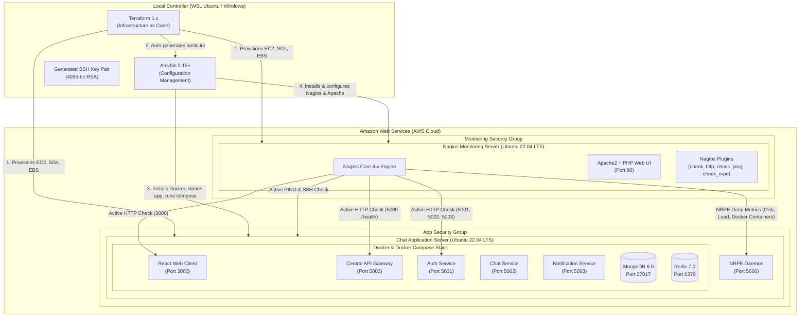
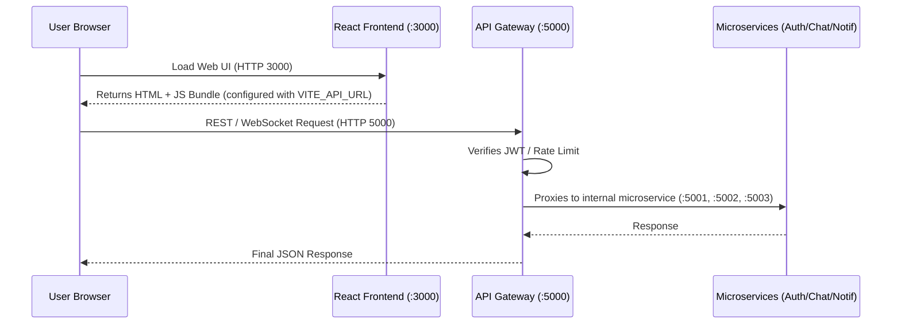
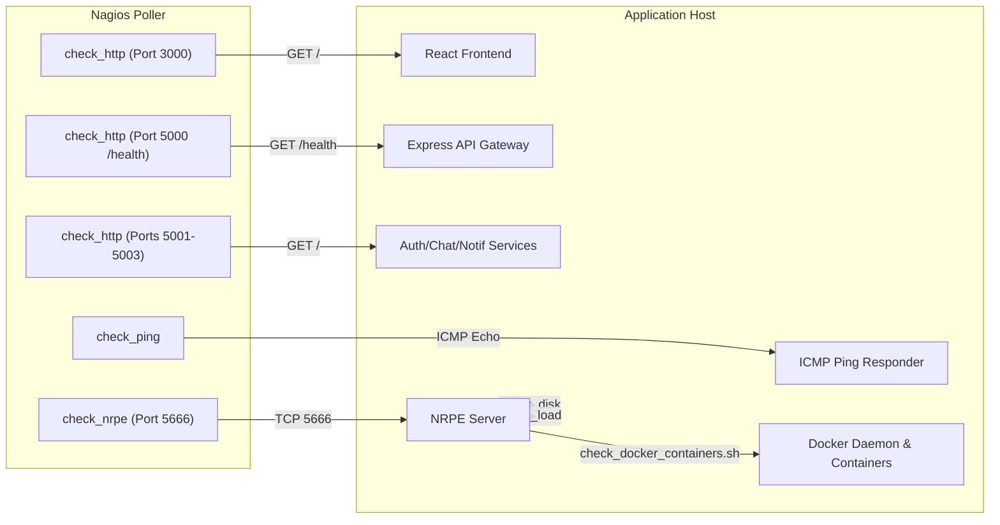

# System Architecture & Technical Design

## 1. High-Level Architecture Overview

This project implements an automated, production-grade DevOps deployment and continuous monitoring pipeline for a real-time microservices-based chat application. The system integrates **Terraform** for Infrastructure as Code (IaC), **Ansible** for automated configuration management and container orchestration, and **Nagios Core** for infrastructure and microservices health monitoring.

---

## 2. Infrastructure as Code (Terraform)

Terraform orchestrates the complete cloud infrastructure lifecycle declaratively on Amazon Web Services:

1. **EC2 Instances**:
   - **Chat Application Server (`app-server`)**: `t3.medium` (or `t2.medium`), 25 GB gp3 EBS root volume, Ubuntu 22.04 LTS. Sized to easily build and run 7 simultaneous Docker microservices.
   - **Nagios Monitoring Server (`monitoring-server`)**: `t3.micro` (or `t2.micro`), 15 GB gp3 EBS root volume, Ubuntu 22.04 LTS.
2. **Security Groups**:
   - `app_sg`:
     - Port 22: Restricted SSH administration.
     - Port 3000: Inbound HTTP for React Client.
     - Port 5000: Inbound HTTP for API Gateway.
     - Ports 5001, 5002, 5003: Inbound HTTP for direct microservice health verification.
     - Port 5666: Inbound NRPE encrypted monitoring from the Nagios server.
     - ICMP: Echo ping reachability from Nagios server.
   - `monitoring_sg`:
     - Port 22: Restricted SSH administration.
     - Port 80: Inbound HTTP for Nagios Core Web Dashboard.
3. **Automated SSH Key Management**:
   - Uses `tls_private_key` to generate a 4096-bit RSA key pair dynamically if no key is provided, saving it with `0600` permissions and attaching it to the instances.
4. **Automated Dynamic Inventory Synthesis**:
   - Using the `local_file` provider, Terraform automatically outputs `ansible/inventory/hosts.ini` containing the newly allocated public and private IP addresses, preventing manual copy-paste errors.

---

## 3. Configuration Management & Deployment (Ansible)

Ansible is organized into modular roles adhering to DevOps standards:

| Role | Target | Responsibility |
| :--- | :--- | :--- |
| **`common`** | All Nodes | System updates, baseline packages (`curl`, `git`, `htop`, `jq`), swap file setup (2GB to prevent build OOM), timezone sync. |
| **`docker`** | App Server | Official Docker CE repository setup, Docker Engine, Docker Compose Plugin, and user permissions (`usermod -aG docker ubuntu`). |
| **`app_deployment`**| App Server | Clones source repo from GitHub (`prince093kumar/winter_pep_final_project`), generates dynamic `docker-compose.override.yml` with current server IP, builds & launches containers, polls health endpoints. |
| **`nrpe_client`** | App Server | Installs `nagios-nrpe-server`, configures allowed hosts (`nrpe.cfg`), installs custom `check_docker_containers.sh` script to inspect running microservices. |
| **`nagios_server`** | Monitoring Server | Non-interactive installation of Nagios 4 & Apache2, htpasswd auth (`nagiosadmin`), configuration of hosts, service checks, commands, contacts, and automatic root HTTP redirect. |

---

## 4. Dynamic IP Injection Mechanism

The chat application contains client-side React code and an API Gateway that require the public IP address of the deployment server:

To eliminate hardcoded IP addresses, Ansible generates a `docker-compose.override.yml` using Jinja2 templating:
- Injects `CLIENT_URL=http://<app_server_ip>:3000` into `api_gateway`.
- Injects `VITE_API_URL=http://<app_server_ip>:5000` build argument into `chat_client`.
- Exposes internal service ports (`5001`, `5002`, `5003`) to allow direct monitoring checks by Nagios.

---

## 5. Monitoring & Failure Detection Architecture

Nagios Core runs continuous polling cycles against the Application Server using both **Active Network Checks** and **Passive/Agent NRPE Checks**:

### State Transitions during Failure
1. **Normal Operation**: All checks return exit code `0` (`OK` - Green).
2. **Failure Introduced** (e.g. `docker stop chat_service`):
   - Active HTTP check on port 5002 returns `Connection Refused` (Exit code `2` -> `CRITICAL`).
   - NRPE `check_chat_containers` detects `chat_service` is missing/stopped (Exit code `2` -> `CRITICAL`).
   - Gateway `/api/messages` routes return 502/504 Bad Gateway.
   - Nagios triggers notification state and highlights the service in red.
3. **Recovery Introduced** (`./scripts/recover_service.sh`):
   - Container starts and binds to socket within 5 seconds.
   - Next polling cycle checks return exit code `0`.
   - Nagios transitions to `RECOVERY` (`OK` - Green).
